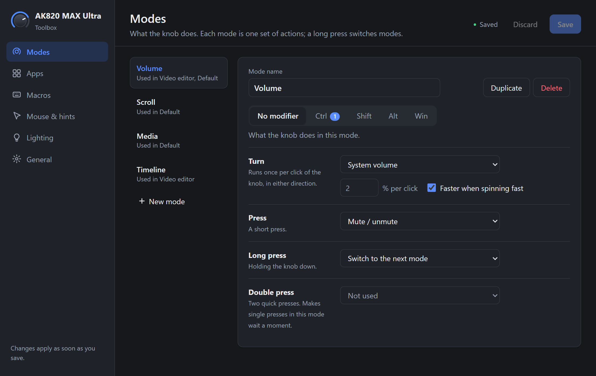
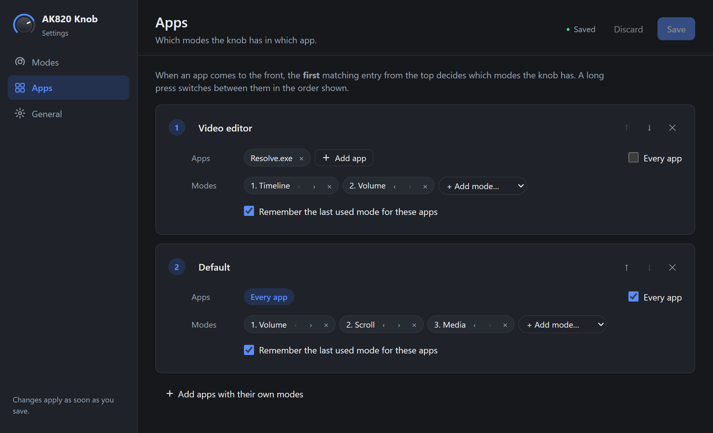
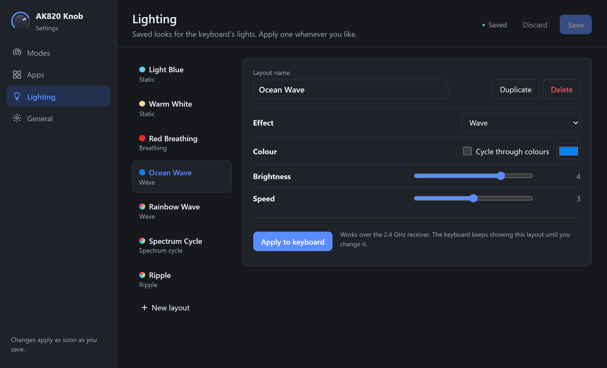

# AK820 MAX Ultra Toolbox

Free, open-source software that adds what the **AJAZZ AK820 MAX Ultra**
keyboard is missing on Windows. It gives the knob new jobs:
scrolling, zooming, media control, the volume of a single app, any key
combination, and different functions in different apps. It also adds macros,
a mouse you control from the keyboard, click-by-letter hints for any app or
website, and lighting layouts.

By default only the knob changes: every other key, including Fn+F2 / Fn+F3
for volume, works exactly as before. Macros, mouse mode and click hints stay
off until you turn them on. This is unofficial, free and
[open-source](#unofficial-free-and-open-source) software, with a
[project website](https://enceladus00.github.io/ak820-max-ultra-toolbox/) too.

[](https://github.com/Enceladus00/ak820-max-ultra-toolbox/releases/latest/download/ak820-custom-knob-setup.exe)



## What the knob can do

The knob has three gestures: **turn**, **press** and **long press**. Each
**mode** gives them a job, and a long press switches to the next mode. It
comes with three modes, and you can change them or add your own:

| Mode | Turn | Press | Holding Ctrl while turning | Holding Shift while turning |
|---|---|---|---|---|
| Volume | System volume | Mute | Volume of the app in front | |
| Scroll | Scroll | Middle click | Zoom | Scroll sideways |
| Media | Right / left arrow key | Play / pause | Next / previous track | System volume |

A short popup shows the new mode when you switch.

The available actions:

* system volume, or the volume of only the app in front
* mute
* scroll (up/down or sideways, faster when you spin fast), zoom
* press any key or key combination, with a different one per direction
  (for example `.` and `,` to step through a paused YouTube video frame by
  frame)
* mouse click (left, middle, right)
* switch to the next mode
* the knob's normal behaviour, or nothing

**Modifier layers:** each mode can give the knob other jobs while you hold
Ctrl, Shift, Alt or Win.

**Per-app modes:** choose which modes the knob has in which app, for example
only a "Timeline" mode in your video editor. It switches automatically when
another app comes to the front, and can remember the last mode you used
there.



**Double press** is available too, for rarely needed actions. Modes that use
it make a single press wait a moment to see whether a second one follows.

## Macros

Save a sequence of key presses, typed text, waits and mouse clicks, and start
it with a hotkey or a knob gesture. Press **Record** to capture keys and the
pauses between them, then edit the steps. A macro can repeat a set number of
times or until stopped; press its hotkey again or Esc to stop it. Text in a
macro is stored unencrypted in the config file, so don't put passwords in one.
Some games don't allow macros, so check their rules first.

## Mouse mode

Control the pointer from the keyboard, handy when you sit away from your desk.
Turn it on in Settings, then press its hotkey (Ctrl+Alt+M by default) or a knob
gesture:

| Key | What it does |
|---|---|
| Arrow keys | Move the pointer |
| Right Ctrl | Left click (hold to drag) |
| Right Shift | Right click |
| End | Middle click |
| Page Up / Page Down | Scroll |
| Home (hold) | Move slowly, for precise aiming |
| Esc | Leave mouse mode |

All other keys keep typing as usual. Mouse mode turns itself off after 10
minutes without use, so the arrow keys never stay taken over by accident.

## Click hints

No more pressing Tab over and over to reach a button. Turn it on in Settings,
press its hotkey (Ctrl+Alt+H by default) or a knob gesture, and a small letter
label appears on everything clickable in the app in front. Type a label to
click it, or hold Shift on the last letter to right-click. Esc or any other key
closes the labels. It works in most apps and in Chrome and Edge.
You can change how the labels look in Settings: colours, size, roundness,
opacity, position and shadow, or pick a ready-made style.

## Lighting

Save lighting layouts with an effect, a colour or colour cycling, brightness
and speed, then click **Apply to keyboard** to use one. It comes with seven
layouts and 19 effects. The lights only change when you apply a layout.



## Supported keyboards

| Keyboard | Connection | Status |
|---|---|---|
| AJAZZ AK820 MAX Ultra | 2.4 GHz dongle | Supported and tested |
| | USB cable | Not tested yet |
| | Bluetooth | Not tested yet |
| Other AK820 MAX versions | | Not tested; some use different hardware |

**Have a different AK820 MAX?** This program has only been tested on the MAX
Ultra. Other versions sold as AK820 MAX can use different hardware, and it
only recognises a 2.4 GHz receiver that Windows sees as `VID_0C45&PID_FEFC`.
With the receiver plugged in, this PowerShell command lists it if you have
that one:

```powershell
Get-PnpDevice -PresentOnly | Where-Object InstanceId -match 'VID_0C45&PID_FEFC'
```

You can also just install it: if the tray icon stays grey with a red badge
while the receiver is plugged in, your version isn't supported yet.

Windows 10 or 11, 64-bit. When the knob isn't recognised (for example over
the cable), the program does nothing and the knob keeps its normal volume
function.

## Install

1. Click **Download for Windows** above. Your browser downloads
   [`ak820-custom-knob-setup.exe`](https://github.com/Enceladus00/ak820-max-ultra-toolbox/releases/latest/download/ak820-custom-knob-setup.exe).
2. Open the downloaded file. If Windows SmartScreen warns about an unknown
   publisher, choose *More info → Run anyway*; the program isn't code-signed
   yet. See [Privacy](#privacy) for exactly what it does.
3. Click through the installer. It needs no administrator rights.
4. At the end, the knob program starts and Settings opens. Turn the knob.

Prefer not to install? The
[Releases](https://github.com/Enceladus00/ak820-max-ultra-toolbox/releases) page
also has `ak820-custom-knob-portable.zip`: unpack it anywhere and run
`ak820-custom-knob.exe`, keeping both exe files in the same folder.

## Use

The program runs in the notification area (tray), next to the clock.

* **Click** the tray icon to open **Settings**.
* **Right-click** it for the menu: the current mode, *Paused* (the knob
  works as normal until you turn it back on), *Start with Windows*,
  Settings, the config file, the log folder, and Quit.

In **Settings**:

* **Modes:** what the knob does in each mode, with and without a modifier
  held. To record a key, click the key field and press the key or
  combination.
* **Apps:** which modes the knob has in which app. Entries are checked from
  the top; the first that matches the app in front wins.
* **Macros:** record or build macros, and give them a hotkey.
* **Mouse & hints:** turn on mouse mode and click hints and set their hotkeys.
* **Lighting:** saved lighting layouts (effect, colour, brightness, speed).
  Edit them, then click **Apply to keyboard**. It comes with seven, and it
  works over the 2.4 GHz receiver.
* **General:** Start with Windows, theme (light, dark, or same as Windows),
  language, long-press and double-press timing, and Restore defaults.

Changes apply as soon as you save. There's no need to restart the program.

### Config file

Settings are stored in `%APPDATA%\ak820-custom-knob\config.toml`. You can
also edit this file by hand; the program picks up saved changes right away,
and keeps the last working settings if the file has an error.
[`default-config.toml`](crates/knob-core/src/default-config.toml) describes
every option.

## Privacy

To see the knob, the program installs a Windows keyboard hook, which lets it
see every key press. By default it only acts on the volume and mute keys and
lets everything else through untouched. If you turn on macros, mouse mode or
click hints, it also acts on the keys those features use. It doesn't record or
store what you type, its log files contain no key presses, and it never
connects to the internet. Macro recording only captures keys pressed inside
the Settings window while you are recording.

## How it works

The knob sends the same volume-up / volume-down / mute signals as Fn+F2,
Fn+F3 and Fn+F4. The difference is timing: a knob step is released after
about 5 ms, while a finger holds a key for 70 ms or more. The program holds
back volume keys for up to 30 ms. If one came from the AK820 and was released
by then, it's the knob. Otherwise it's a real key press, which is passed on
unchanged.

If the program ever fails, the knob falls back to its normal volume
function instead of going silent. Details are in [docs/design.md](docs/design.md)
and the measurements behind them in
[docs/probe-findings.md](docs/probe-findings.md).

## Uninstall

Use *Settings → Apps → AK820 MAX Ultra Toolbox → Uninstall* in Windows. It asks
whether to delete your settings and logs too. For the portable version, turn
off *Start with Windows* in the tray menu, quit, and delete the folder.

## Building from source

Needs [Rust](https://rustup.rs) (stable, with the MSVC toolchain) on
Windows.

```
cargo build --release -p ak820-custom-knob -p knob-settings
```

The two exe files end up in `target\release`. `cargo test --workspace` runs
the tests, including a replay of a real recording from the keyboard.

To build the installer and portable zip into `dist\`, install
[Inno Setup 6](https://jrsoftware.org/isinfo.php) and run:

```
powershell -ExecutionPolicy Bypass -File tools\build-release.ps1
```

Published releases are built by GitHub Actions instead; see
[docs/releasing.md](docs/releasing.md).

The workspace:

| Crate | What it is |
|---|---|
| `knob-core` | Knob detection, gestures, modes and config, with no Windows code |
| `knob-rgb` | The lighting protocol, with no hardware code |
| `knob-win` | Keyboard hook, Raw Input, sending keys, per-app volume, applying lighting |
| `ak820-custom-knob` | The tray program |
| `knob-settings` | The Settings window ([Tauri](https://tauri.app)) |
| `knob-probe` | A diagnostic tool that logs what the keyboard sends |

## FAQ

**How do I remap the knob on the AJAZZ AK820 MAX Ultra?**
Install the program, open Settings, and on the **Modes** page choose what
turning, pressing and long-pressing the knob should do. Save, and the knob
uses the new functions right away.

**Can I bind a keyboard shortcut to the AK820 MAX Ultra knob?**
Yes. Choose *Press keys*, click the key field and press any key or
combination. Turning clockwise and counter-clockwise can each have their own.

**Can the knob do different things in different apps?**
Yes. The **Apps** page sets which modes the knob has in each app, and it
switches automatically when another app comes to the front.

**Can I use the AK820 MAX Ultra as a mouse?**
Yes. Turn on **Mouse mode** and the arrow keys move the pointer, with the keys
next to them for clicking and scrolling.

**Can I record macros on the AK820 MAX Ultra?**
Yes. On the **Macros** page press **Record**, press your keys, then give the
macro a hotkey or bind it to the knob.

**Why doesn't it work in an app I run as administrator?**
Windows doesn't let normal programs control apps running as administrator.
Hotkeys, mouse mode and click hints work everywhere else.

**Do I need the official AJAZZ software or driver?**
No. This program works on its own.

**Does it change my keyboard's firmware?**
No. The knob functions all run on your PC and write nothing to the keyboard.
Lighting settings are sent to the keyboard only when you click *Apply to
keyboard*, and they don't touch the firmware.

**Does it work with the regular AK820 MAX, AK820 Pro, MAX Plus or MAX HE?**
It has only been tested on an AK820 MAX Ultra over its 2.4 GHz receiver. Other
models and versions use different hardware or haven't been tested. If yours
isn't recognised, the program does nothing and the knob keeps working normally.

## Contributing

Everyone is more than welcome to build on this project, with features for
the knob or for anything else on the keyboard. Have an idea? Open an issue
to talk it through, or send a pull request. Bug reports are just as welcome.

To add a language, see [docs/translating.md](docs/translating.md). If your
knob isn't recognised, for example over the cable or Bluetooth, a log from
`knob-probe` helps add support for it.

## Notes

**Fn+F4 (mute) counts as a knob press.** The keyboard sends exactly the same
signal for both, and both are finger presses of similar length, so they
can't be told apart. In a mode where the press does something else (Scroll
mode: middle click), Fn+F4 does that too.

## Unofficial, free and open source

AK820 MAX Ultra Toolbox is a community project. It isn't made, endorsed or
supported by AJAZZ.

All of the code is public, so anyone can read exactly what it does, and
releases are built by GitHub Actions from that public code
([how to check a download](docs/releasing.md#checking-a-download)).

As the license says, it is provided as-is, without warranty, and the author
isn't responsible for problems that come from using it. If something doesn't
work, please [open an issue](https://github.com/Enceladus00/ak820-max-ultra-toolbox/issues).

## License

[Apache License 2.0](LICENSE).
